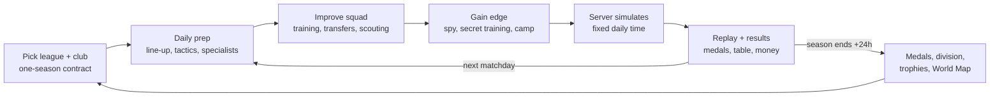

# Online Soccer Manager (OSM): The Complete Analysis

Research snapshot: **29 October 2026**. Current edition: **OSM 26/27**, app version **4.14.48**.

This is a full reference on Online Soccer Manager: what it is, where it came from, and how every system works. It is written to serve as the design reference for this repository (`online-soccer-manager-copy`).

## How to read this document

Every rule is tagged by how it was established:

| Tag | Meaning |
|---|---|
| **[V]** | Verified. It comes from an official source (Gamebasics help centre, FAQ, Terms, App Store or Google Play listing, Miniclip press release), from **OSM's own public web-client code**, or from several independent sources that agree. |
| **[C]** | Community. It comes from player guides, fan wikis, forum posts or third-party trackers. Treat it as field knowledge, not as the developer's specification. |

**The web client is the strongest primary source.** OSM's browser client ships its JavaScript publicly at `osm.cloud/sb/*.js` (build v32583 was read for this report). It contains the game's enums and data models: tactics, positions, staff, timers, league modes, finances and match data. Wherever a rule below says "client", it was read directly from that code.

Server-side numbers (exact training gains, prices, match-engine weights) are **not** in the client. Gamebasics does not publish them. Those gaps are listed in [Section 22](#22-known-unknowns).

---

## 1. OSM at a glance

| | |
|---|---|
| **What it is** | A free-to-play, online, multiplayer football management game. You manage one real club per slot in a league full of other human managers, for one season at a time. |
| **Developer** | Gamebasics B.V., trading as **Miniclip Nederland**, Buitenom 263, Zoetermeer, Netherlands [V] |
| **Owner** | **Miniclip**, which Tencent has majority-owned since Feb 2015. Miniclip announced the acquisition on 19 Jan 2021; the price was not disclosed [V] |
| **Created by** | Jeroen Derwort, with his brother Bowie Derwort; Frank Tijhuis joined as business partner in 2005 [V] |
| **First playable** | September 2001, as a browser hobby project [V] |
| **Platforms** | Web (onlinesoccermanager.com), iOS/iPadOS (since Nov 2010), Android (since Oct 2012), Mac (Apple silicon), visionOS. One account works on all of them [V] |
| **Business model** | Free-to-play. Revenue comes from in-app purchases (Boss Coin packs, $0.99–$99.99 on the App Store), rewarded video ads, banner ads and an offerwall ("Business Club") [V] |
| **Ratings** | App Store US 4.7★ from 62K ratings. Google Play 4.62★ from 2.67M ratings, 50M+ downloads [V] |
| **Audience** | 3M+ monthly users at the 2021 sale [V]. The store copy says "over 50 million players" [V]. The largest markets are Turkey, Egypt, Brazil, the Netherlands and Indonesia, plus Iran through Cafe Bazaar [C] |
| **Languages** | 21 on the App Store; the store copy says 30 [V] |
| **Age rating** | Apple 9+ (loot boxes, advertising, chat). Google Play: "Everyone" in the US, **PEGI 16** in the EU and UK [V] |
| **Studio size** | 90+ staff, up from 60 in 2021 [V] |
| **Recognition** | Best Studio, Dutch Game Awards 2025 [V] |

---

## 2. The story

### Timeline

| When | What happened |
|---|---|
| 1998–2000 | Jeroen and Bowie Derwort make *Avalon*, a freeware DOS RPG [C] |
| **Sep 2001** | Jeroen Derwort, a student, starts OSM as a one-man hobby project in his parents' attic in **Zoetermeer**. The first build runs on Classic ASP, an Access database and a home server [V for attic/Zoetermeer/2001; C for the tech stack] |
| 17 Dec 2001 | onlinesoccermanager.com is registered [C] |
| **2004** | **Gamebasics** is founded to take OSM international. Derwort's Leiden University master's thesis that year is titled *"Online soccer manager going global"* [V] |
| 2004–2006 | Side projects: Bondscoachspel (national-team manager), Match of the Week, Poule & Play, and a contribution to Plaza Challenge [V] |
| 2005 | **Frank Tijhuis** joins as business partner and co-founder figure [V] |
| ~2010 | The studio drops its other management games and focuses on OSM [V]. Growth comes through **Turkey and Jordan** after the English version disappointed (Derwort, 2024 podcast). The Arabic and mobile versions drive the breakout [V] |
| **6 Nov 2010** | iOS app (id400201466) first released [V tracker date] |
| Nov 2011 | 1M monthly active users [C] |
| **Oct 2012** | Android launch. OSM reports 1.9M active users and 17 languages [V] |
| Jan 2014 | iPad/universal app. Gamebasics reports more than 4M monthly actives [V] |
| 2014 | AdMob case study: 4M MAU, 91% male, 27% under 18. Ads make 25% of revenue and IAP 75%; 90% of users never pay [V] |
| 2014, 2016 | Two acquisition attempts fail [V] |
| 2015 | Licensing partnership with Belgium's **Pro League**: official crests and player photos [V] |
| **2016** | **OSM 3**: a full overhaul of app and website, "inclusion of football rights", and a new microtransaction model. **Boss Coins** arrive [V/C] |
| 2016/17 | Jeroen Derwort leaves Gamebasics [V] |
| 2017 | Persian edition *Morabbi-e Bartar* on Iran's Cafe Bazaar [C] |
| Mar 2018 | **Crews** (group play) launch [V] |
| 2018 | Co-founder Frank Tijhuis dies at 50 [V] |
| Sep 2019 | **Tournaments** (European knockout format) launch after a beta with hundreds of thousands of users [V] |
| May 2020 | **Winners Cup** launches [V] |
| Nov 2020 | **Fantasy League** launches [V] |
| **19 Jan 2021** | **Miniclip acquires Gamebasics.** Team of 60, 3M+ monthly users. Jasper Schwartz is Gamebasics CEO; Jurgen Post is Miniclip CEO [V] |
| Apr 2021 | **Knockout Royale** (prize-pool knockout) [C] |
| ~2021 | **Specific positions** (GK, CB, LB, RB, CDM, CM, CAM, LM, RM, ST, LF, RF) [V client; date C] |
| Sep 2021 | Missions [V] |
| Sep 2022 | Custom avatars removed because of user-generated-content risk [V] |
| **4 Nov 2022** | Studio renamed **Miniclip Netherlands**; new Zoetermeer office opens [V] |
| Mar 2023 | **Position Modifier** items; training reminders [V] |
| Oct 2023 | Derwort publishes *SCOREN!* (English edition *SCORE!*, Dec 2025), covering "hackers, lawsuits", growth and the sale [V] |
| Mar 2024 | Blocking users in private messages [V] |
| ~mid-2025 | Weekly mission track (7 days, one day unlocks daily) [V] |
| May 2025 | Huawei AppGallery version sunset; migrating players get 100 BC [V] |
| Dec 2025 | Studio wins **Best Studio** at the Dutch Game Awards [V] |
| Jun 2026 | **Quick Matches** against legendary World Cup teams, timed with the 2026 World Cup (v4.14.33–35) [V] |
| 2026 | Store title becomes **"OSM 26/27"** in step with the real season [V] |
| 20 Oct–3 Nov 2026 | **"Halloween in OSM!": Scary Switchers**, position-changing players sold as a limited "Rarity" [V] |

### What the story tells you

1. **It grew from the long tail, not from England.** The breakout came from the Middle East (Turkey, Jordan, an Arabic version), then Brazil, Indonesia and Egypt. That shaped the product: light on time, phone-first, social leagues among friends.
2. **It has been a live service for 25 years.** The rules have barely changed in that time: one match a day, real leagues, compete against friends. Each era added layers on top: Boss Coins (2016), Crews (2018), Tournaments (2019), Winners Cup and Fantasy (2020), specific positions (2021), and events, missions and rarities (2023–26).
3. **2016 was the pivot.** OSM 3 brought licensed football rights and switched from ad-plus-premium-days to a Boss Coin economy. Every modern system hangs off that currency.
4. **Miniclip turned it into a studio franchise.** Headcount went from 60 to 90+ and the studio added titles (Football Head Coach 2022, "Ultimate Football Manager" 2025). OSM remains the flagship.

---

## 3. The core concept

OSM is **an asynchronous, multiplayer, one-season football manager.**

- **A league is an instance.** Every league is a separate, numbered copy of a real competition, such as Premier League #12,345, hosted on a named simulation server. Each club in the instance has at most one human manager. Clubs without one are run by the CPU [V].
- **You sign a one-season contract.** "OSM is a one-season game. After a season with a team ends, you will have to choose a new team" (official FAQ) [V]. There is no promotion or relegation and no multi-season dynasty. Every season starts fresh.
- **Squads start from real-world data.** Rosters and leagues are updated roughly monthly from real football [V]. Player names are real, while crests and photos depend on licences [V].
- **There are two regions,** "World" and "The Netherlands", fully separated [V].
- **One account, four manager slots.** You run up to **four clubs in four different leagues at once**. Slot 1 is open from the start; in the client's logic slot 2 unlocks **5 days** after sign-up, slot 3 after **20 days** and slot 4 after **50 days** [V client]. Money does not move between slots [C].
- **Progress across seasons comes from your manager, not your club.** Medals, divisions, achievements, the trophy cabinet and the World Map carry over. Squads and club money do not.

### Why the one-season design works

- It caps how long any advantage lasts, including paid advantages.
- It gives an endless supply of fresh starts.
- New players always face fair conditions, because everyone in a league starts the same day.
- It makes the "pick a club" moment (Real Madrid or an underdog) a recurring, aspirational choice.

---

## 4. The season loop

### Calendar

- **One match per real day** [V]. Each day is either a league matchday or a cup round; cup rounds take their own days [V].
- A 20-team league therefore lasts about **38 days plus cup days, roughly 6 weeks** [C].
- **League phases** (client `LeaguePhase`) [V]:
  - **PreparationPhase:** pre-season. The moderator can switch it off in custom leagues.
  - **DuringLeaguePhase:** the regular season.
  - **LastDayPhase:** the final day.
  - Tournaments add **PoulesPhase** (groups) and **KnockoutPhase**.
- **Simulation time is fixed per server.** The countdown in the game counts down to that server's simulation [V]. You cannot change it manually. Your profile's "match time preference" picks which server new leagues land on (client `UserPreferredMatchSimulationTimeRange`) [V].
- **Joining is cut off late in the season.** A league closes to new joiners after a server-set percentage of its matchdays (`CannotJoinLeagueAfterWeekPercentage`) [V client].
- **End of season:**
  - The league **resets 24 h after the final match** and you choose a new club [V].
  - Ties in the table break on goal difference, then goals scored, then alphabetical order [V].
  - Top finishers in qualifying leagues get a **Winners Cup ticket**, which must be claimed within 7 days into a free slot [V].

### A manager's day

The game spells the routine out as a **Match Preparation** checklist with a completion score running Critical, Poor, Mediocre, Good, Great, Perfect [V client]:

1. Starting XI complete
2. Bench complete
3. Starters in their **correct specific positions**
4. Starters **fit**
5. **Specialists** set: captain, penalties, free kicks, corners
6. **Spy** on the opponent (Data Analyst)
7. **Training sessions** completed
8. **Friendlies** played
9. **Secret Training** used
10. **Training Camp** used

Around that checklist sit the market and the club:

- The transfer list and incoming offers
- Scout missions
- Doctor and Lawyer
- Stadium upgrades
- Sponsors
- Daily rewards, missions and events

The match itself is simulated on the server at the fixed time. You watch it afterwards as a **Match Experience** replay [V].

---

## 5. Competitions and modes

| Mode | How it works |
|---|---|
| **League** | The core mode: a real league instance with mixed human and CPU clubs. Size follows the real league, from 8 teams (Canada, Moldova, Singapore, Taiwan) to 20 [V/C] |
| **Domestic cup** | Knockout from preliminaries up to the round of 128. Ties go to extra time (to 105 and 120 min) and then penalties. Matches are played at a neutral ground [V] |
| **Custom league** ("Create League", paid in Boss Coins) | The creator becomes moderator. It can be **private** (invite or approve) or **open**. Settings: team count, budget, cup on/off, preparation days, transfers on/off, Boss Coin transfers on/off, training camp or secret training allowed, timer boosts, consumables, crew cup [V client]. Continuing it into the next season costs BC (`ContinueCustomLeague`) [V] |
| **Winners Cup** (since May 2020) | Ticket-only, for top finishers of trophy-marked leagues. 32 human managers, a 6-match group stage, then home-and-away knockouts with a neutral final [V/C]. Players also call it the "Champions Cup" |
| **VIP League** | Invitation ticket (`InvitedForVipLeagueEvent`). League or tournament format, 20 teams over 38 matchdays [V/C] |
| **Tournaments** | Real competitions: national-team events (World Cup, Euro, Africa Cup of Nations), continental club cups (Champions League, Libertadores) and monthly historical editions such as "Europe 2004". Eliminated managers can stay and watch [V] |
| **Knockout Royale** (PrizePool) | Paid entry (40 BC, restored May 2023). Starts once 128 entrants have joined. Prizes are paid from the round of 32 up [V] |
| **Fantasy League** (since Nov 2020) | 10 managers draft squads of 20+ players from a 100M budget. Each player can sit in only one squad. Private fantasy leagues cost 200 BC, are CPU-filled after 24 h, give 1 h to build a squad and have no cup [V] |
| **Crew Battles** | Crews (clans) face each other in a shared league. The battle league moves to a new country every ~2 weeks. App battles have 10 participants. Crew divisions award points for wins, draws and losses [V] |
| **Retro / Special / Beta leagues** | Past seasons (e.g. Eredivisie 16/17, a "2009" league with an era player pool), TOTS leagues, Community Leagues and the Friendly Battles League [V/C] |
| **Friendlies** | Unlimited [V store]. Friendlies cause no injuries or red cards and don't change fitness or morale [C]. Under secret training an opponent cannot challenge you [V] |
| **Quick Matches** (Jun 2026) | App only. You play legendary World Cup teams for rewards using "energy" (client `EnergyWallet`). A weekly reward ladder pays only its final tier [V] |
| **Match Prediction** | Predict real fixtures, with themes such as Euro 2024 and Champions Cup, for rewards [V client] |

---

## 6. Players

### Stats [V client]

- Every player carries **three numbers: Attack (`statAtt`), Defence (`statDef`) and Overall (`statOvr`)**.
- **Overall = floor((Attack + Defence) / 2)**, as computed in the client's level-up code.
- Each line uses one stat as its **main stat**:

| Line | Main stat |
|---|---|
| Forwards (A) | Attack |
| Midfielders (M) | Overall |
| Defenders (D) and goalkeepers (G) | Defence |

- **A training level-up adds +1 to the main stat:**
  - Forward: Attack +1
  - Midfielder: Attack +1 **and** Defence +1, so Overall +1
  - Defender or goalkeeper: Defence +1
- Ratings go **above 100**. The line-up strength badge is **blue** below 80, **bronze** at 80+, **silver** at 90+ and **gold** at 100+.
- Other per-player fields:
  - Age, nationality, market **value**, asking price
  - **Fitness** and **morale**
  - Goals, assists, matches played, average grade per match
  - Yellow-card count, injury, suspension, training progress, squad number
  - **Style**: AttackMinded, Balanced or DefensiveMinded

### Positions [V client]

- **Four lines:** G, D, M, A.
- **Twelve specific positions:** GK, CB, LB, RB, CDM, CM, CAM, LM, RM, ST, LF, RF.
- The preparation checklist rewards putting starters in their **correct specific position**:
  - A player on his own spot gets a small boost [C, moderator].
  - A player on another spot in the **same line** gets a small penalty [C].
  - A player in a **different line** gets a large penalty. The UI colours the mismatch [C].
- **Position Modifier** consumables (Mar 2023) permanently change a player's position. There are 25 kinds: Universal, Attacker, Midfielder, Defender, and specific moves such as CB→LB, CM→CAM, CDM→CAM, ST→LF and LB→RB [V client]. The Halloween 2026 "Scary Switchers" are this mechanic sold as an event rarity [V].

### Rarities [V client]

| Rarity | What it is |
|---|---|
| **Default** | Normal players |
| **Legend** | Retired greats, released onto the transfer list during "Legends" events at about 100 BC each [V forum] |
| **In Form** | Boosted versions of players in real-world form |
| **Evolution** | Players with enhanced training progression |
| **World Star** | A separate star level (`WorldStar1`) |

- **Player packs** come in **Bronze, Silver and Gold**. Each pack has published draw odds by rarity (`PlayerPackOdd`: percentage, rarity, stat range) [V client]. The App Store flags OSM for **loot boxes** for this reason [V].
- **Variable training progression** tiers run None, Rare, Epic, Elite, **Legendary** [V client]. These are the "extreme progression" boosts sold in events and packs.

### Condition, injuries and discipline

- **Fitness and morale** both have a "big impact on performance" [C wiki]. Field rule: don't start players below ~85% fitness [C].
- **Injuries:** each injury type has a minimum and maximum duration in weeks and a probability [V client]. The **Doctor** treats a player, cutting **1–3 matches** per treatment, with each treatment taking about 8 h [V staff/C].
- **Cards:**
  - Yellow and red cards each carry a probability and a ban length [V client].
  - Three yellows means a one-match ban [C].
  - The **Lawyer** can appeal a suspension once per player, taking about 8 h [C].
  - Bans and injuries count down one day per matchday [C].
- **Referees** have five strictness levels: VeryStrict, Strict, Average, Lenient, VeryLenient [V client]. Players call them by colour: red, orange, yellow, blue and green [C]. The referee is assigned per match, so the right tackling level changes every day.

---

## 7. Team strength and the match engine

### The strength number

- The big number in the match preview ("MANCHESTER CITY **89** VS **89** REAL MADRID") is the **average main stat of the best players for each line of the chosen formation** [V client `getAverageLineupStrength`].
- For a 4-4-2 the client takes:
  - the best GK's Defence
  - the 4 best defenders' Defence
  - the 4 best midfielders' Overall
  - the 2 best forwards' Attack
  - It averages all 11 values and rounds the result.
- Formation codes encode the slots: hundreds digit = defenders, tens = midfielders, units = forwards [V client].
- The game also shows **per-line averages** for attack, midfield and defence.

### What the engine records [V client `MatchData`]

For **each side**, the server stores:

- Attack, Defence and Overall values
- Formation and its A/B variant
- Chances, possession, corners, fouls
- Whether a **Training Camp** was active
- Goalkeeper
- Manager points
- **Accuracy**

For the match as a whole it stores the **field balance** (left, middle, right) and the **man of the match**.

So the engine resolves a match from line strengths, tactics and boosts, and outputs chances, possession and the flank balance. The exact weights stay on the server and are unpublished.

### Event model [V client]

| Category | Events |
|---|---|
| Goals | Goal, header, bicycle kick, volley, long-range shot, penalty goal, corner goal, free-kick goal |
| Chances | Chance, penalty chance, corner chance, free-kick chance |
| Finishes | Miss, keeper save, woodwork |
| Discipline | Yellow, second yellow, red |
| Other | Injury, substitution, VAR goal approved / rejected / to be overturned |

- **Phases:** pre-match, first half, half-time, second half, extra-time halves, penalties, after match.
- **Commentary** comes from a **Host** and a **Pundit**, with expression states such as Neutral, Hopeful, Happy, Disappointment, Disapproval and "Ouch".

### Simulation facts

- **Matches are pre-computed.** The server simulates at the scheduled time and the client **replays** the finished event list. On web it shows one simulated minute every 125 ms with a 2 s half-time pause, and it can be skipped [V client].
- **There are no live changes.** You set the bench; substitutions are made by the engine/assistant [V client; C moderator].
- **Home advantage runs through the stadium pitch.** Every match records `isPlayedOnNeutralGround`, and the spy report exposes the opponent's **pitch level and pitch bonus** [V client]. Pitch levels 1/2/3 are commonly given as +2/+4/+6% at home [C].
- **Nationality bonus:** fielding about 6 starters of one nationality triggers a bonus [C]. Its size is disputed: a moderator said "around 25%", while players measure 5–6%.
- **Randomness is built in.** Stronger squads lose; the help centre itself fields reports from managers beaten by weaker squads [V]. Gamebasics publishes no win-probability curve.

---

## 8. Tactics

Every option below is **read from the client** [V]. Effects are community knowledge [C] unless marked.

### Formations: 12 shapes × A/B = 24

| Formation | Variant A | Variant B |
|---|---|---|
| 4-3-3 | CM-CAM-CM | CM-CDM-CM |
| 4-4-2 | flat: LM-CM-CM-RM | diamond: CDM, 2×CM, CAM |
| 4-5-1 | LM-CM-CDM-CM-RM | LM-CM-CAM-CM-RM (the "4-2-3-1") |
| 4-2-4 | 2×CM | 2×CDM |
| 3-4-3 | ✓ | ✓ |
| 3-5-2 | LM-CAM-CDM-CAM-RM | LM-CDM-CM-CDM-RM |
| 3-3-4 | ✓ | ✓ |
| 3-2-5 | 2×CDM + 5 forwards | 2×CDM + 5 forwards |
| 5-2-3 | ✓ | ✓ |
| 5-3-2 | CM-CAM-CM | CAM-CM-CAM (the "5-3-1-1") |
| 5-4-1 | ✓ | ✓ |
| 6-3-1 | ✓ | ✓ |

### Game plan (`TacticOverall`): five options

| Option | Client name |
|---|---|
| Long ball | `LongBall` |
| Passing game | `PassingGame` |
| Wing play | `PlayWide` |
| Counter attack | `CounterAttack` |
| Shoot on sight | `ShootOnSight` |

### Tackling (`TacticStyleOfPlay`)

| UI label | Client name |
|---|---|
| Careful | Fair |
| Normal | Normal |
| Aggressive | Hard |
| Reckless | Extreme |

Harder tackling means more defensive bite but **more cards, injuries and stamina drain**. Match it to the referee: Careful against a very strict referee, Aggressive against a lenient one [C].

### Sliders (integer, about 0–100)

| Slider | Effect [C] |
|---|---|
| **Pressing** | Higher wins the ball back sooner but costs stamina |
| **Style / Mentality** | Named steps: VeryDefensive 0, Defensive 20, Neutral 40, Offensive 60, VeryOffensive 80 [V] |
| **Tempo** | Higher means quicker play and more stamina use |

### Line instructions

| Line | Options (client name, then UI label) |
|---|---|
| Forwards | FallBack = Drop deep · SupportMidfield = Support midfield · AttackOnly = Attack only |
| Midfield | SupportDefense = Protect the defence · Neutral = Stay in position · AttackingMidfielders = Push forward |
| Defence | StayBack = Defend deep · UpcomingBacks = Attacking full-backs · SupportMidfield = Support midfield |

### Other settings

- **Marking:** Zonal or Man-to-man. Zonal suits defensive set-ups; man-marking suits attacking set-ups with matching numbers [C].
- **Offside trap:** On or Off. It works better with fewer defenders [C].
- **Specialists:** Captain, Penalty, Free kick, Corners [V]. Field rules [C]:
  - Captain: the oldest starter.
  - Penalties: the best forward.
  - Free kicks: the best midfielder or forward.
  - Corners: the best midfielder.
  - No more than two roles per player.

### The tactical philosophy

The official FAQ says there is **no single best tactic**: it depends on your squad and your opponent's, and you should test many in matches and friendlies [V].

The design makes that true in three ways:

- **Information is hidden.** You only see an opponent's set-up by paying for the **Data Analyst**.
- **The analyst report is incomplete.** It shows formation, game plan, tackling, marking, offside trap and line-up. It does **not** show the pressing, style or tempo sliders or the line instructions [V client].
- **You can block spies.** **Secret Training** blocks spying and friendlies against you.

---

## 9. The meta: counter-tactics the community uses [C]

These are player-derived heuristics, not developer rules.

### Pairing formations with game plans

The game plan must fit the formation's identity:

| Game plan | Formations |
|---|---|
| Long ball | 4-2-4, 3-3-4, 3-2-5, 5-2-3 |
| Passing game | 4-4-2B, 3-5-2, 4-5-1 |
| Wing play | 4-3-3, 3-4-3 |
| Counter attack | 6-3-1, 5-4-1, 5-3-2, 5-2-3 |
| Shoot on sight | 4-5-1 (A/B), 5-4-1B |

### Matchups

- **Long ball** against a dominant midfield.
- **Counter attack** against a stronger or over-attacking opponent.
- **Shoot on sight** against a deep, compact block.
- **Passing game** against an equal or weaker side.

### The 26/27 meta (Oct 2026 guides)

**4-3-3 A/B with Wing play** is the default answer to almost everything. Typical slider settings, as Pressure/Style/Tempo:

| Situation | Formation and plan | Pressure/Style/Tempo |
|---|---|---|
| Stronger side | 4-3-3 A/B, Wing play | ~65–68 / 65–72 / 54–65 |
| Even game | 4-5-1B ("4-2-3-1"), Shoot on sight | ~55 / 52 / 58 |
| Much weaker, away | 4-5-1 or 5-3-2, Counter or Shoot on sight | ~38 / 35 / 72 |

- Defaults: zonal marking, offside trap off.
- Use **Aggressive** tackling only against lenient referees.
- Raise tempo and style when you are stronger, and lower them when you are the underdog.

---

## 10. Training and coaches

### Coaches [V]

- **Four line coaches:** Attacking (forwards' Attack), Midfield (midfielders' Attack + Defence), Defending (defenders' Defence) and Goalkeeping (keeper's Defence).
- **Each coach trains one player at a time,** from his own line only, so four players train in parallel.
- **Coaches are fixed.** There is no hiring or upgrading. They were introduced in their current form in the Nov 2019 staff relaunch [V].
- **Universal Trainer:** a **fifth, paid** coach that trains one extra player of any position, with "slightly higher progression in a slightly shorter time". It costs **25 BC per 24 hours** [V moderator/staff; tested from Oct 2024]. In the client it is `TrainerType.Universal`, with its own timers [V client].
- **Claim progression:** a finished session adds nothing until you claim it. "Training progression it's only effective after you claim it" [V staff]. The coach cards in the current UI carry the progress % and the *Claim progression* button.

### Progression [V/C]

- A full bar (100%) = **+1 to the main stat**. Midfielders gain +1 Attack and +1 Defence, so Overall +1 [V client].
- **Typical gain per session:**

| Player rating | Gain per session |
|---|---|
| Below 100 | **50–80%** of a level [V moderator] |
| 100 and above | **20–40%** of a level [V moderator] |

- Gains fall off sharply above ~100–110 [C].
- **"On Fire" sessions** randomly give a full 100% [C].
- **Diminishing returns:** about 3 sessions per player per matchday is the practical limit [C].
- **Age:** young players gain more. 30+ players count as "experienced" and gain less, except during **Golden Oldies** events [V].
- **Progression tiers** (`VariableTrainingProgression`): None, Rare, Epic, Elite, Legendary [V client]. Events labelled "Higher Training Progression (when claiming)" [V], inventory items (+10%, +25%, +100% for about 50 BC) and the $2.49 "Progression" purchase feed these tiers.
- **Training Facility** (a stadium part): +10% / +25% / +50% progression at levels 1/2/3 [C].
- **Friendlies** give progression to the players fielded in them. League matches don't [V staff]. Each friendly costs about 4 BC, with shrinking returns [C].
- **No conflict with matchday:** since ~Jan 2025, players in training can start matches with no penalty, and can be sold [V moderator]. The server variable `AllowPlayerInTrainingInLineup` controls this [V client].

### Timers

| Timer | Default | Event versions |
|---|---|---|
| Training session | **8 h** [V] | Super Staff 2 h, Extreme Training 3 h, Top Facilities 4 h, Stadium Blitz 5 h [V official event schedule] |
| Universal Trainer | ~6 h [C] | Always shorter than the line coaches during events [V] |

- **Speed-ups:** Boss Coins finish a session instantly; one rewarded video cuts 2 h [C, current forum]. Older guides gave 2 BC per hour and 30 minutes per video [C 2020].

### How to train well [C]

- Keep all four coaches busy all the time. Idle timers are the biggest waste in OSM.
- Train the players who start every match. The strength badge counts only the best N per line.
- Claim progress before the simulation.
- Lean on young players while they still progress fast.

---

## 11. Transfers and scouting

### Ways to acquire a player [V client `TransferType`; V FAQ]

| Route | How it works |
|---|---|
| **Transfer list** | Players listed by computer and human clubs, domestic and foreign |
| **Scout** | Up to 6 criteria (line, specific position, age, quality, style, nationality, league). Returns with **3 players** after a **16 h** trip; Super Staff makes it 4 h and some events 2 h. Scouted players are **reserved for 30 minutes**. Signing one costs club funds **plus 15 BC** [V]. **World Star (100+) scouting** was added in Feb 2022 and costs extra BC: 50 → 55 → 68 BC by 2026 [V/C] |
| **Negotiations** | Bid on any club **in your own league**, human or computer. Computer clubs don't reply in pre-season, then answer at the next transfer round. Offers stay open until rejected and can't be blocked. `OfferStatus`: Created, CounterOfferSent, Accepted, Rejected, Withdrawn [V] |
| **Special offer** | A time-limited player deal priced in club funds and/or BC [V client] |
| **Legends / In-Form** | Event rarities. A Legend costs the transfer-list price **plus 100 BC** [V staff] |
| **Player pack** | Bronze, Silver or Gold. Gives **3 random players**, with odds by rarity, and must be used within 7 days [V] |
| **Quick sell** | Sell instantly **at player value for 5 BC** [V staff]. The percentage is a server variable (`QuickSellPricePercentage`) [V client] |

### Market rules

- **No transfer windows.** The market runs all season unless a custom-league moderator switches it off [V].
- **No loans.** "We will not do a loan on players to prevent cheating" [V moderator].
- **No wages and no player contracts.** The only "contract" in OSM is the manager's own one-season deal [V].
- **Price band:** asking price runs from **0.75× to 2.5× value** [C]. The cap is the server variable `MaxSalePercentage` [V client]. This is the main brake on value-pumping between friends.
- **Listing limit:** up to **4** players at once, or 6 during Transfer Madness [V].
- **Transfer rounds:** the market engine adds listings and makes purchases **up to 9 times a day at random times** [V moderator].
- **Computer-listed players** drop in price each round, never below value, and are pulled at about 1.2× value [V moderator].
- **Selling is probabilistic.** Higher asking prices sell slower, late-season sales are harder, players under €10M sell easily and €30M+ players are hard to move. Staff confirmed sale chance and margins are formula-driven [V].
- **Shortfalls:** if the league's "club funds compensation" setting is on, Boss Coins cover a funds shortfall [V].
- **Anti-collusion:** Terms point 8 bans using transfers to give one club an unfair advantage, and joining and resigning to collude. Manager-to-manager bids are capped by hidden limits [V/C].

### Player value [C]

There is no official formula. Fan calculators show that value **roughly doubles with every +10 rating** and declines with age (about 1% a year until 30, faster after).

| Rating | Approximate value |
|---|---|
| 80 | ~€10M |
| 90 | ~€21M |
| 100 | ~€39M |
| 110–115 | €120–150M late in a season |

---

## 12. Club: finances, stadium, sponsors, board

### Finances [V client `TeamFinance`, V forum]

- **Fixed income** arrives every matchday. A lower club objective means a smaller fixed income [C].
- **Gate receipts and sponsor money come only from home matches.** Cup ties are on neutral ground and pay about half [V].
- **Savings earn 2% per match,** but only if the money sits in Savings during the simulation [V moderator]. Events can raise the rate. The bank works through `MoneyTransferType` Deposit / Withdraw [V client].
- **Transfers are the main income;** tickets are minor [C].
- **Staff are free.** Since Dec 2020 the Doctor, Lawyer, Data Analyst, Scout and Coaches cost no club funds [V staff]. The client still carries a server-set "% of budget" price hook for the Data Analyst [V client].
- **Club money stays in its slot** and is lost when the season resets [V]. Savings carry into the Winners Cup [C].
- No debt, bankruptcy or financial-sacking rules exist in any source [V by absence].

### Stadium [V client]

- **Three parts,** each with levels, XP thresholds, a bonus and an upgrade timer:

| Part | Bonus |
|---|---|
| **Capacity** | Ticket income only |
| **Pitch** | Home performance; +2/+4/+6% at levels 1/2/3 [C] |
| **Training Facility** | Training progression; +10/+25/+50% [C] |

- **Upgrade timer:** **18 h** [V]. Stadium Blitz cuts it to 4 h; ads cut 2 h, up to 3 times [V/C].
- **Number of upgrade steps** grows with the league's length [V].
- **Paid in club funds,** or in BC when funds run short [C].
- **Example payback:** a capacity level costs ~€0.74M and adds ~€0.14M per home match [C].
- **No ticket-price setting** exists [C].

### Sponsors [V]

- **One slot per stand: North, East, South, West** (`SponsorSide`) [V client].
- **Offers scale with league position against your objective** [V staff].
- **Deals run for a number of home matches** (1–3 weeks) [V].
- **Pick at least one to get paid.** Several can run at once [V].
- **No per-win or per-goal bonuses** [V by absence].

### Board and objective [V client]

- Every club has a **goal**: a target league position set by the board (Chairman, Advisor, Analyst).
- **Board mood:**

| Situation | Mood |
|---|---|
| Pre-season | Satisfied |
| No ranking yet | Hopeful |
| Above target or 1st | Happy |
| Exactly on target | Satisfied |
| Below target | Angry |

- **The board never sacks you for results.** You lose a club only by:
  - **resigning:** blocked in pre-season, on the last day and in about the final 20% of the season; final, and counted on your profile;
  - **being kicked by a custom-league moderator** for 72 h+ inactivity;
  - **being removed by staff** for cheating [V].

---

## 13. Staff

`StaffMemberType` lists the staff [V client]. All of them are free in club funds since Dec 2020 [V].

| Staff | What they do | Time |
|---|---|---|
| **Data Analyst** (the "Spy" until 2019) | Reports the next opponent's formation and variant, game plan, tackling, marking, offside trap, line-up, pitch level and bonus, and camp status [V client]. The report is deleted after the matchday [C] | ~1 h; 15 min in Super Staff [C/V] |
| **Scout** | Filtered player search returning 3 players | 16 h; 4 h or 2 h in events [V] |
| **Doctor** | Cuts **1–3 matches** off an injury per treatment, one player at a time, repeatable. Injuries also tick down one per matchday [V staff/C] | ~8 h; 3 h in Super Staff [C/V] |
| **Lawyer** | One suspension appeal per player. Can't appeal a yellow-accumulation ban [C] | ~8 h; 3 h in Super Staff [C/V] |
| **Four line coaches** | Training (section 10) | 8 h |
| **Universal Trainer** | Extra coach for any position, 25 BC per 24 h | ~6 h |

- Every staff timer can be sped up with BC or a rewarded video. Ad speed-ups are capped at 3 per hour [V].
- The client's cast of characters ("dudes") adds Manager, Assistant, Trainer, Chairman and Agent. They voice tutorials, news and offers [V client].

---

## 14. Match boosts

| Boost | Effect |
|---|---|
| **Training Camp** | **+25%** for the next match [V moderator]. The value is `CampBoostPercentage`, set on the server [V client]. Limited to **6 per league**, costing **10 → 20 → 50 → 100 → 200 → 500 BC** [C]. **The opponent gets a push notification** ("OpponentTrainingCamp") [V client] unless you also run Secret Training [V moderator] |
| **Secret Training** | Hides your tactics from the Data Analyst, blocks friendly challenges and masks your camp notification. Adds a small boost, about +2.5% (`SecretBoostPercentage`) [V/C]. **3 BC**, 6 per league [C] |
| **Daily-login streak** | A consecutive-login track adds a `matchBoost` on top of the camp [V client] |
| **Pitch level** | +2/+4/+6% at home [C] |
| **Nationality bonus** | About 6 starters of one nationality; size disputed [C] |
| **Match preparation** | Completing the checklist in section 4 is the free baseline |

Custom leagues can switch off training camps, secret training and consumables to make a purely skill-based league [V client].

---

## 15. Boss Coins and monetisation

### The two currencies

| Currency | Earned from | Spent on |
|---|---|---|
| **Club funds** | Gate receipts and sponsors (home matches), fixed income, prize money, player sales, 2% interest per match on savings | Players (transfer fees), stadium upgrades. There are no wages, and staff have been free since Dec 2020 |
| **Boss Coins (BC)**, the premium currency | Purchase, daily rewards, achievements, division climbing, Business Club offerwall, rewarded videos (1 BC per ad, capped per hour), missions, events, season completion [V/C] | Speed-ups and premium actions (see the list below) |

- Boss Coins are shared across all of a manager's slots and platforms [V].
- BC can be converted to club funds (client `BossCoinConversion`) [V client].

### Everything Boss Coins buy

From the client's `PaidGameOption`, the authoritative list [V client]:

| Area | Paid actions |
|---|---|
| Stadium | Upgrade stadium; boost a stadium upgrade |
| Training | Start training; boost training; universal trainer |
| Staff | Send scout; boost scout; start a lawyer case; boost a lawyer case; start doctor treatment; boost doctor treatment |
| Transfers | Transfer a player; quick-sell |
| Team training | Secret training; training camp |
| Analyst | Spy; boost spy |
| Clubs and leagues | Pick an unavailable (already-managed) team; create a closed league; continue a custom league; create a crew; create a public fantasy league |
| Other | Friendly; shop purchase |

### Price points (App Store US, 29 Oct 2026) [V]

| Pack | Price |
|---|---|
| Small Pack | $0.99 and $1.99 |
| Medium Pack | $4.99 |
| Elite Pack | $4.99 |
| Large Pack | $9.99 |
| X-Large Pack | $19.99 |
| Boss Pack | $24.99 and $99.99 |
| Super Pack | $49.99 |
| Progression | $2.49 |

- Google Play lists items from $0.10 to $199.99 [V].
- There is **no subscription and no battle pass** [V].
- Packs include "items with randomized rewards", i.e. player packs [V].
- Payment providers named in the Terms: Apple, Google, Facebook, Huawei, Cafe Bazaar, PayPal, Adyen, Centili and others [V].

### Ads

- **Rewarded video** pays BC (1 BC each, capped per hour), cuts 2 h off training or stadium timers, or replaces a small BC fee when signing a transfer [C].
- Video ads run in a **3-ad streak** with rising cash rewards (client `WatchAdsStreak`) [V/C].
- Purchases remove **banner** ads only [C].
- Mediation runs Google AdMob, Meta, AppLovin, Unity and Fyber (15 networks), plus AppsFlyer, Firebase and CleverTap [C tracker].
- Offerwall partners in the client include Fyber, Tapjoy, ironSource (SuperSonic), TrialPay, SponsorPay, AdInPlay and others [V client].

### Revenue mix

- 2014 (official AdMob case study): IAP 75%, ads 25%, and 90% of players never pay [V].
- Oct 2026 tracker estimates put revenue at about $300K–400K/month across both stores, with the split now leaning toward ads [C, low confidence].

### Pay-to-win, measured honestly

- **Gamebasics' stance:** a strong squad comes from active management, and "every manager can use Boss Coins to speed up this process", whether bought or earned [V].
- **Guards against pay-to-win:**
  - The one-season reset.
  - Training camps are limited to 6 per league, with escalating cost.
  - Transferring value between accounts is banned.
  - Custom leagues can disable camps, secret training, BC transfers and consumables [V client].
  - The Terms let Gamebasics cap how much currency can be held or spent [V].
- **The criticism:**
  - Escalating Training Camp prices still let payers stack match boosts at key moments.
  - Legends and In-Form players sell for BC.
  - Player packs are random.
  - "Pay to win" is a recurring review theme from 2019 to 2026 [C].

---

## 16. Live operations

- **Monthly event rotation.** Each event bends one system for a few days [V forum schedule; C wiki]:

| Event | Effect |
|---|---|
| **Legends** | Legend players listed for BC |
| **Training Camp Mania** | Camp discounts |
| **Stadium Blitz** | 4 h stadium upgrades (normally 18 h) |
| **Transfer Madness** | Up to 6 players listed; scout takes 2 h instead of 16 h |
| **Super Staff** | Staff timers slashed: training 2 h, scout 4 h, doctor and lawyer 3 h, analyst 15 min |
| **Golden Oldies** | Older players train faster |
| **Bargain Scout** | Cheaper scouting |
| **Intense Friendlies** | Boosted friendlies |
| **Top Facilities** | Facility boosts |
| **Extreme Training** | Big progression boosts |
| **In Form** | In-Form players listed |
| **High Sell Chance** | Easier to sell players |
| **All Out** | Everything boosted at once |
| **Universal Trainer Discount** | Cheaper universal trainer |

  The client's `EventNotificationType` lists all of these [V client].

- **Store "in-app events"** on Apple and Google, e.g. **Halloween in OSM! – Scary Switchers**, 20 Oct–3 Nov 2026 [V].
- **Real-football tie-ins** [V]:
  - The yearly edition rebrand (OSM 25/26, then 26/27).
  - Themed leagues and tournaments: Euro 2021, World Cup 2022, Euro 2024 predictions.
  - Quick Matches against World Cup legends for the 2026 World Cup.
- **Retention loops** [V client]:
  - A daily login reward track with streak match boosts.
  - A weekly 7-day mission track.
  - Achievements in Beginner, Intermediate and Expert tiers.
  - Missions.
  - Push notifications for match results, offers and opponent camps.
  - Match prediction.
- **Release cadence:** 25 builds in 7 months of 2026, mostly fixes. Content changes ship as server-side events, not app updates [V].

---

## 17. Social layer

- **Friends** come from Facebook, email or in-game invites. Friend suggestions [V client]:
  - added you
  - friend of a friend
  - same crew
  - same league
- **OSM Chat** handles 1-to-1 messages and needs a verified email. Blocking was added in Mar 2024 [V].
- **Crews** (since 2018) are clans. Each has a name, tag, motto, level and XP, a president, VPs and members, a recruitment setting (open, request or invite-only), crew ranking divisions and **Crew Battles**. Crew chat links out to WhatsApp, Discord, Messenger or Telegram [V].
- **The league newspaper ("Press Room")** is auto-generated daily. Article types: promotion, squad, schedule, results, league, moderator, weather, photo and manager comment [V client].
- **Official channels:** forum (forum.onlinesoccermanager.com/.nl), Discord (~36K members), Reddit, Facebook page and group, Instagram, X (@osmlikeaboss) [V].

---

## 18. Manager progression

- **Medals** are stored as `skillRating` and earned per match across all four slots [V].
  - A win against an active human earns more than a win against the CPU.
  - Humans inactive 72 h or more count as CPU.
  - End-of-season match and cup bonuses add more (client `SkillRatingBonusType`) [V].
- **Divisions** are skill tiers (`SkillRatingTier`) [V].
  - The higher your division, the fewer medals a win earns and the more a loss costs [V].
  - Climbing a division pays Boss Coins [V].
- **Rankings** come in user, country and world tables, recalculated nightly [V].
- **Career, Trophy Cabinet and World Map** ("World Domination") track the share of the world's competitions you have played. The store copy invites you to "complete the World Map" [V].

---

## 19. Fair play and moderation

- **Rules** (Terms and help centre) [V]:
  - One account per person.
  - No account takeovers.
  - No **illegal transfers** (lopsided deals between human clubs).
  - No **collusion** (one person running several clubs, or managers fielding losing set-ups on purpose).
  - No offensive names.
- **Lock reasons** in the client [V]:
  - multi-account by password, by machine ID, or general
  - illegal transfers
  - forum spam or swearing
  - other
  - Unlock outcomes: doubtful, mistake, admitted guilt, "bought tickets", other.
- **Reporting** uses the in-game "report cheater" button, which requires being in the same league or tournament. Appeals go by replying to the verdict email [V].
- **Inactivity:**
  - In custom leagues, the moderator can kick managers inactive for a server-set number of days (`NotSackableDays`; ~72 h) [V].
  - Public "OSM" leagues never remove managers mid-season [V].
  - Accounts inactive for 3 years are deleted [V].
- **EU DSA 2025 transparency report:** 346 moderation actions, 202 suspensions, 103 terminations [V].
- **Field complaints:** multi-accounts farming closed leagues, slow report handling, scam impersonators on WhatsApp and Telegram [C].

---

## 20. Reception and audience

- **Store standing:**
  - Google Play US: 4.62★ from 2,670,705 ratings (5★ 2.17M, 1★ 120K).
  - App Store US: 4.7★ from 62K ratings [V].
- **Recent review sample:** the latest 1,000 App Store reviews (US and GB, Jun 2021–Oct 2026) average **3.7★** [C].
  - **Praised for:**
    - leagues with friends
    - real clubs and players
    - low time demand
    - years-long loyalty
    - fewer ads than rivals
  - **Criticised for:**
    - bugs after updates
    - Boss Coin costs and pay-to-win
    - long ads
    - "scripted" upsets
    - one match a day
    - forced English commentary (Oct 2026)
- **Who plays:**
  - In 2014: 91% male, 27% under 18 [V].
  - Today's biggest markets: Turkey, Egypt, Brazil, the Netherlands, Indonesia and Iran [C].

---

## 21. Competitors and position

| Game | Model | How OSM differs |
|---|---|---|
| **Top Eleven** (Nordeus, Serbia; Take-Two since 2021, $225M upfront) | F2P mobile manager, 240M+ registered | OSM uses **real** leagues, clubs and players and one-season instances; Top Eleven is built around your own long-lived club |
| **Hattrick** (Sweden, 1997) | Browser, one match a week, fictional players | OSM is faster (daily) and real-world-data-driven |
| **Soccer Manager** (Invincibles Studio, UK) | Yearly editions, Man City licence | Closest analogue; OSM leans on multiplayer instances |
| **Football Manager Mobile** (SI/SEGA; via Netflix since FM26) | Premium single-player simulation | OSM is social, F2P and low-depth by design |

**OSM's position:** the lightest real-data multiplayer manager. It is designed for five minutes a day across four clubs, competing against friends.

---

## 22. Known unknowns

None of the following is published by Gamebasics or exposed in the client. All of it lives in server-side game variables:

- Match engine weights.
- How strength difference converts into win probability.
- The size of the randomness.
- Exact effects of home advantage, out-of-position play, fitness and morale.
- The size of the nationality bonus.
- Exact training-point gains and progression curves by age.
- Current BC prices per action and the coins in each IAP pack.
- Player-pack odds tables (the model exists; the values are served).
- Slot-unlock rules on the server side.
- The join cut-off percentage and the inactivity-kick days.
- Sponsor formulas and stadium cost curves.
- Revenue figures (Gamebasics publishes none).

---
## 23. Blueprint: what a faithful copy needs

This section turns the analysis into a build spec for this repository. Names follow the OSM client's own domain model, so the concepts map one-to-one.

### Core loops

| Loop | Cadence | Systems |
|---|---|---|
| **Match loop** | Daily | Line-up → tactics → spy → boosts → simulation → replay → result |
| **Squad loop** | Hours | Training timers → coaches → transfers → scouting → doctor and lawyer |
| **Club loop** | Days | Stadium upgrades → sponsors → finances → board objective |
| **Season loop** | ~6 weeks | Choose club → play the season → reset → medals and division → choose again |
| **Meta loop** | Months | Four slots, divisions, rankings, achievements, World Map, crews, Winners Cup, events |
| **Monetisation loop** | Continuous | Timers and scarcity → Boss Coins (earned or bought) → speed-ups and boosts |

### Domain model

Field names follow the OSM client (`models.js`).

| Entity | Key fields |
|---|---|
| **User / Manager** | name, country, skillRating (medals), division tier, **teamSlots[4]**, resignCount, crew |
| **LeagueType** | Template of a real competition: name, continent, teamCount, weeks, hasCup, totalCupRounds, allowTransfers, scheduleType, theme |
| **League** | Instance: id, leagueType, seasonNr, weekNr, phase (Preparation / During / LastDay / Poules / Knockout), mode (Normal / Crew / Battle / WinnersLeague / Vip / PrizePool), moderator, settings[], simulation server and time |
| **LeagueSetting** | Closed, TeamCount, Budget, Cup, PreparationDays, Transfers, BossCoinTransfers, IsTrainingCampAllowed, IsSecretTrainingAllowed, BoostTimers, ConsumablesAllowed, HasCrewCup, Discontinue |
| **Team** | name, city, budget, **goal** (board objective rank), stadium, ranking, trainingCampCount, trainSecretCount, tactic, finance, players |
| **Player** | name, age, nationality, position (G/D/M/A), specificPosition (12), **statAtt / statDef / statOvr**, style, value, price, fitness, morale, yellowCards, injury, suspension, rarity, trainingProgress, grades |
| **TeamTactic** | formation + detail (A/B), overallMatchTactics (5 game plans), style (4 tackling levels), pressing, mentality, tempo, marking, offsideTrap, attack/midfield/defense line instructions |
| **Match / MatchData / MatchEvent** | Per side: Att/Def/Ovr, formation, chances, possession, corners, fouls, camp, keeper, accuracy. Also field balance L/M/R, man of the match, minute-by-minute events, commentary |
| **TeamFinance** | fixedIncome, boardingSponsors, gateReceipts, savings, balance, interest |
| **Stadium / StadiumPart** | Capacity, Pitch, TrainingFacility, each with levels, XP thresholds, bonus (percentage or club funds) and an upgrade timer |
| **Sponsor** | One per stand (North/East/South/West): fixedFactor, weeks, weeksLeft, revenue |
| **Staff actions** | ScoutInstruction (position, age, quality, style, nationality, league), SpyResult, DoctorTreatment, LawyerCase; all are timer-driven |
| **Transfers** | TransferPlayer (list, special offer, scout, quick-sell, cash-buy, legend, in-form), Offer + Bids (human negotiation), Transfer (history) |
| **Economy** | BossCoinWallet, EnergyWallet, BossCoinProduct, PlayerPack + odds, RewardTrackDay, UserMission, Achievement, UserReward |
| **Social** | Crew, CrewMember (President / VP / Member), CrewBattle, Friends, Conversation, NewspaperArticle |

### Rules a copy must implement first (minimum viable OSM)

1. **Real-data league templates.** Seed leagues, clubs and players with Att/Def/Ovr and positions.
2. **Instances.** Create a league instance on demand. Humans claim clubs and the CPU runs the rest. Cut off joining after X% of the season.
3. **One-season contract.** The league resets 24 h after the last match.
4. **Daily server simulation at a fixed time per instance,** producing a stored event log that the client replays.
5. **Team strength.** Average the best N per line by main stat (forwards Att, midfielders Ovr, defenders and GK Def). This is the baseline input to the engine.
6. **Tactics:** 24 formations, 5 game plans, 4 tackling levels, 3 sliders, 3 line instructions, marking, offside trap, specialists.
7. **Training timers.** One level gives +1 main stat (midfielders +1 Att and +1 Def). Use separate coaches per line.
8. **Transfer market** with CPU and human trades, plus anti-collusion limits (a max sale percentage of value, a quick-sell percentage).
9. **Finances:** gate receipts, four stand sponsors, fixed income, savings with interest.
10. **Board objective:** the board's mood compares current rank against `goal`:
    - **Satisfied** during pre-season.
    - **Hopeful** while there is no ranking yet.
    - **Happy** when above target or 1st.
    - **Satisfied** when exactly on target.
    - **Angry** when below target.

### What makes it OSM rather than just a manager game

- **Four parallel clubs.** Slots unlock at 5, 20 and 50 days.
- **Hidden information as a paid resource:** spy vs secret training.
- **Scarce, timed boosts:** 6 camps per league at escalating prices.
- **Referee strictness per match,** which interacts with tackling.
- **Real-calendar marketing:** the yearly YY/YY edition, tournaments and legends.
- **Low time demand by design:** five minutes a day, one match a day.

---

## 24. Sources

### Official / primary

- App Store listing (description, version history, IAPs, events, privacy): https://apps.apple.com/us/app/online-soccer-manager-osm/id400201466
- Google Play listing and data safety: https://play.google.com/store/apps/details?id=com.gamebasics.osm
- OSM web client code (build v32583): `https://osm.cloud/sb/{enums,models,osm,lineup,tactics,matchExperience,dashboard,spy,teamTraining}.js.v32583`
- Gamebasics FAQ: https://gamebasics.nl/en/faq/
- OSM help centre: https://support.onlinesoccermanager.com/hc/en-us
- Terms and Conditions: https://www.onlinesoccermanager.com/TermsAndConditions and https://gamebasics.nl/termsandconditions/
- DSA transparency report: https://gamebasics.nl/en/dsa-transparency-report/
- Miniclip acquisition press release (19 Jan 2021): https://gamespress.com/Miniclip-Acquires-Dutch-Developer-of-Online-Soccer-Manager-Gamebasics
- AdMob case study (2014): https://www.google.com/admob/pdf/admob-cs-gamebasics.pdf
- Gamebasics blog posts on Crews and Tournaments: https://gamebasics.nl/en/saying-youre-a-social-game-versus-being-a-social-game/ and https://gamebasics.nl/en/the-league-of-champions/
- Jeroen Derwort, *SCOREN!* (book): https://www.jeroenderwort.nl/boek-scoren-online-soccer-manager-osm-van-zolderkamer-tot-skybox/
- Onderneming.nl podcast with Jeroen Derwort (Jul 2024): https://www.onderneming.nl/podcast/online-soccer-manager-jeroen-derwort/

### Industry and press

- Dutch Games Industry studio profile: https://www.dutchgamesindustry.nl/company/gamebasics
- Dutch Games Association: https://dutchgamesassociation.nl/?p=12245
- PocketGamer.biz: https://www.pocketgamer.biz/news/75557/miniclip-snaps-up-dev-gamebasics/
- MCV/Develop, acquisition: https://www.mcvuk.com/business-news/miniclip-acquires-online-soccer-manager-developer-gamebasics/
- MCV/Develop, Netherlands expansion: https://www.mcvuk.com/business-news/miniclip-has-expanded-its-presence-in-the-netherlands/
- Osborne Clarke: https://osborneclarke.com/news/osborne-clarke-advises-miniclip-acquisition-gamebasics
- Rembrandt M&A testimonial: https://www.rma.nl/en/client-testimonials/gamebasics-eng/
- Pplware (PT): https://pplware.sapo.pt/?p=741709
- id.nl (2012 Android launch): https://id.nl/zekerheid-en-gemak/veilig-online/beveiligingssoftware/online-soccer-manager-nu-beschikbaar-voor-android
- iCulture (2014 iPad): https://www.iculture.nl/apps/nederlandse-online-soccer-manager-uitgekomen-op-ipad/
- Pro League partnership: https://www.proleague.be/nieuws/pro-league-extends-partnership-with-gamebasics
- Dutch Game Awards 2025: https://en.dutchgameawards.nl/awards/2025
- Dutch Wikipedia: https://nl.wikipedia.org/wiki/Online_Soccer_Manager

### Community and guides

- Official forum: https://forum.onlinesoccermanager.com (moderator and Community Manager answers)
- OSM fandom wiki: https://online-soccer-manager.fandom.com
- OSM Next Level tactics (Oct 2026): https://www.osmnextlevel.com/en/osm-tactics/
- OSM Tactics Assistant: https://osmtacticsassistant.com
- OSM Helper guideline: https://osmhelper.com/guideline/
- Level Winner beginner's guide: https://www.levelwinner.com/online-soccer-manager-20-21-beginners-guide-tips-tricks-strategies-for-winning-more-consistently/
- GamingOnPhone guides: https://gamingonphone.com/guides/online-soccer-manager-21-22-guide-tips-to-earn-money-quickly/
- Turkish 2026 tactics guide: https://www.oyundunyasi.net/oyun-rehberi/osm-en-iyi-taktik/
- AppGoblin tracker: https://appgoblin.info/apps/400201466
- AppPricingLab tracker: https://apppricinglab.com/app/apple/400201466
- AppRank tracker: https://apprank.io/osm-25-26-soccer-manager-game
